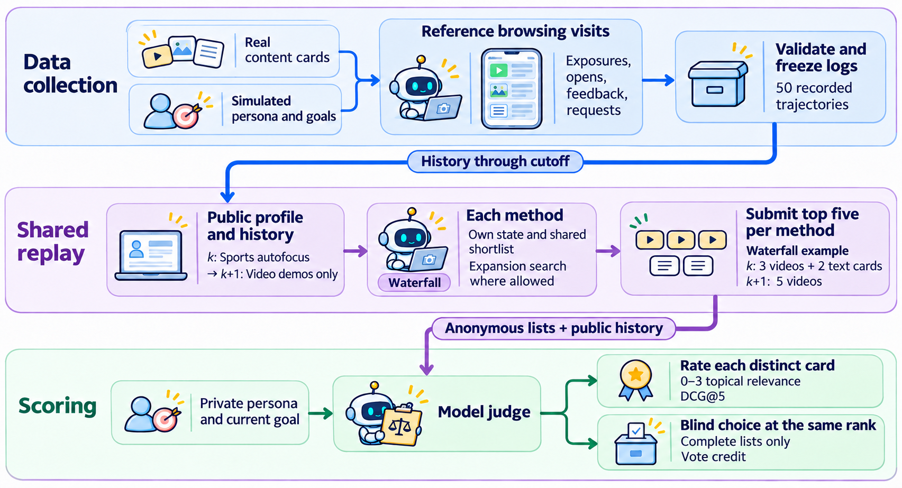

# Waterfall Dataset

Waterfall Dataset records 50 simulated users browsing a feed. Each trajectory follows one user as they see cards, open items, and revise requests. We evaluate recommendations at 300 points along those trajectories.

[Waterfall code and demo](https://github.com/XiaoLuoLYG/waterfall-anything) · [Leaderboard](https://xiaoluolyg.github.io/agentic-waterfall-dataset/) · [Public benchmarks](dataset/docs/public-benchmarks.md)



## Get the data

- [Waterfall Dataset release](https://github.com/XiaoLuoLYG/agentic-waterfall-dataset/releases/tag/waterfall-dataset-v1) has the trajectories, checkpoints, frozen catalogs, submitted rankings, and model judgments.
- [Public benchmark downloads](dataset/docs/public-benchmarks.md) links to the original sources for AgentRecBench, KuaiRand-1K, KuaiRec, ClawRec-SimBench, and MIND-small.
- [Results and replay](dataset/releases/waterfall-dataset-v1/README.md) shows how to recalculate scores from the saved outputs.

### Recalculate the Waterfall Dataset scores

Download `waterfall-dataset-v1-score-replay.zip` from the release and extract it.

```sh
unzip waterfall-dataset-v1-score-replay.zip
cd waterfall-dataset-v1
python3 replay.py
python3 replay.py --protocol independent-recall
```

The first command scores the shared-shortlist run in the paper. The second scores the independent-recall run. Both use saved rankings and model judgments.

[Data card](dataset/docs/dataset-card.md) · [File format](dataset/docs/format.md) · [Tools](dataset/README.md) · [Cite this work](CITATION.cff)
